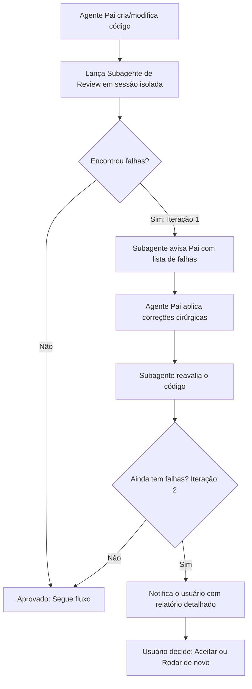

# Code Review Loop (Verificação por Subagente)

Este protocolo é obrigatório sempre que código novo for gerado, refatorado ou modificado.

## Hierarquia de Prioridades
1. **1º Lugar: Legibilidade** (código limpo, autoexplicativo, nomenclatura clara, funções enxutas, KISS).
2. **2º Lugar: Performance e Qualidade** (sem vazamento de recursos, complexidade algorítmica ótima, tratamento correto de erros, tipagem estrita).

## Fluxo Operacional

## Papel do Subagente de Review
- Opera em sessão isolada e com foco estrito em inspeção.
- Não reescreve o projeto; audita cirurgicamente o diff gerado contra:
  - Quebra de sintaxe ou contratos.
  - Violações de legibilidade (nomes crípticos, acoplamento desnecessário, funções gigantes).
  - Problemas de performance, segurança ou regressões.
- Retorna relatório estruturado:
  - `STATUS: APPROVED` se estiver perfeito.
  - `STATUS: REVISION_NEEDED` com lista numerada: `[Arquivo:Linha] - [Falha encontrada] -> [Sugestão de correção]`.

## Regra do Limite de 2 Iterações
1. **Loop 1:** Subagente aponta as falhas -> Agente pai corrige.
2. **Loop 2:** Subagente reavalia -> Se restarem falhas, o agente pai tenta a 2ª correção.
3. **Escalonamento Mandatório:** Se após a 2ª correção ainda restarem falhas não resolvidas, o agente pai **interrompe o loop automaticamente** e envia uma mensagem clara ao usuário descrevendo o problema exato, aguardando a decisão do usuário (aceitar como está ou mandar rodar de novo).
