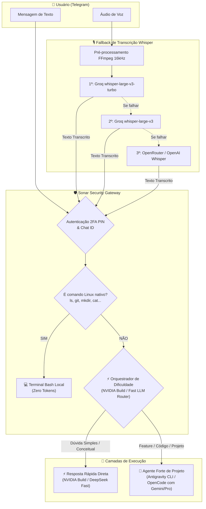

# 🛰️ SONAR: AI Terminal Bridge & Multi-Agent Orchestrator

> **Ponte bidirecional segura para controle remoto de terminal Linux e múltiplos agentes de IA (`Antigravity CLI` e `OpenCode`) via Telegram com Orquestração de Dificuldade (NVIDIA NIM / Fast Router) e Fallback em Cascata de Voz (Whisper STT).**

---

## 🏗️ Arquitetura do Sistema



---

## 🚀 Como Replicar & Rodar (Quick Start em 3 Minutos)

### Pré-requisitos
* **Linux** (Fedora, Ubuntu, Debian, Arch, CentOS/RHEL) ou **Docker**.
* **PHP 8.1+** com extensões: `curl`, `mbstring`, `openssl`, `json` (e opcionalmente `pcntl`).
* **FFmpeg** (opcional, necessário para transcrição de áudio com Whisper STT).

---

### Passo 1: Clonar o Repositório
```bash
git clone https://github.com/Elliton-Luis/sonarCLI.git
cd sonarCLI
```

### Passo 2: Executar o Setup Automático
O script valida todas as dependências, cria as pastas seguras e gera o arquivo `.env`:
```bash
chmod +x setup.sh sonar
./setup.sh
```

### Passo 3: Configurar Credenciais (.env)
Edite o arquivo `.env` e insira seu token obtido no [@BotFather](https://t.me/botfather) e seu Chat ID obtido no [@userinfobot](https://t.me/userinfobot):
```env
TELEGRAM_BOT_TOKEN=seu_token_aqui
ALLOWED_CHAT_ID=seu_chat_id_aqui
```

---

## 🔗 Onde Obter Chaves, Tokens & Acessos

Para que o Sonar funcione com todos os seus recursos de voz, orquestração e agentes, obtenha os tokens nos links oficiais abaixo:

| Serviço | Para que serve | Onde Obter (Link Direto) |
| :--- | :--- | :--- |
| **Telegram Bot Token** | Comunicação principal com o bot | [@BotFather no Telegram](https://t.me/botfather) |
| **Telegram Chat ID** | Autenticação do seu usuário único | [@userinfobot no Telegram](https://t.me/userinfobot) |
| **Groq Cloud API** | Transcrição de áudios de voz instantânea (Whisper Turbo) | [Groq Console Keys](https://console.groq.com/keys) |
| **NVIDIA Build NIM** | Fast Router & Fallback de Sobrevivência (Llama 3.2 90B) | [NVIDIA Build NIM](https://build.nvidia.com) |
| **OpenRouter API** | Fallback para transcrição e modelos de linguagem | [OpenRouter Keys](https://openrouter.ai/keys) |
| **Antigravity CLI** | Agente forte oficial com Gemini e raciocínio profundo | [Antigravity Documentation](https://antigravity.google) |
| **OpenCode CLI** | Agente alternativo de terminal rápido | [OpenCode Portal](https://opencode.ai) |

---

### Links dos Arquivos de Governança & Skills do Repositório:
* [AI.md](./AI.md) - Diretrizes de Engenharia de Software, KISS, YAGNI, Clean Code e Saída Limpa.
* [AGENTS.md](./AGENTS.md) - Regras de Governança e Roteamento Condicional (Progressive Disclosure).
* [GEMINI.md](./GEMINI.md) - Regras e governança para modelos Gemini.
* [.agents/skills/caveman-explore](./.agents/skills/caveman-explore/SKILL.md) - Busca cirúrgica via Linux inteligente (grep/find/sed/awk).
* [.agents/skills/caveman](./.agents/skills/caveman/SKILL.md) - Saída ultra concisa, resposta primeiro e sem enrolação.
* [.agents/skills/code-review-loop](./.agents/skills/code-review-loop/SKILL.md) - Subagente auditor de código com loop de 2 correções.
* [.env.example](./.env.example) - Template seguro de variáveis de ambiente.
* [setup.sh](./setup.sh) - Script de verificação e instalação automatizada.
* [sonar](./sonar) - Utilitário de linha de comando para inicialização e controle.
* [sonar.service.example](./sonar.service.example) - Template de unidade de serviço systemd.
* [Dockerfile](./Dockerfile) - Imagem alpine otimizada para execução isolada.
* [docker-compose.yml](./docker-compose.yml) - Orquestração rápida para execução em containers.

---

### Passo 4: Escolha como Rodar

#### Opção 1: Via CLI Runner (Mais Fácil)
```bash
./sonar start     # Inicia em segundo plano
./sonar run       # Inicia no terminal com logs ao vivo
./sonar status    # Diagnóstico e consumo de memória
./sonar logs -f   # Acompanha os logs em tempo real
./sonar stop      # Encerra a execução
```

#### Opção 2: Como Serviço Systemd (Produção 24/7)
Configura e inicia o serviço de usuário automaticamente:
```bash
./setup.sh --service
```

#### Opção 3: Via Docker Container
```bash
docker compose up -d
```

---

## ⚡ Recursos Principais

### 1. 💻 Terminal Linux Nativo (Zero Tokens)
Execute comandos cotidianos diretamente pelo chat com resposta em milissegundos sem gastar cota de IA:
* `ls -la`, `pwd`, `mkdir pasta`, `cat .env.example`, `rm arquivo`
* `git status`, `git diff`, `git pull`, `git add .`, `git commit -m "..."`, `git push`
* `npm test`, `yarn build`, `composer install`, `docker ps`, `df -h`
* Comandos arbitrários com pipes usando o prefixo `/sh <cmd>` ou `$ <cmd>`.

### 2. ⚡ Orquestração de Dificuldade & Sobrevivência (NVIDIA Build / Fast Router)
Quando uma instrução em linguagem natural chega:
* **Nível 1 (Simples / Dúvida Teórica):** A IA rápida da NVIDIA / Fast Router responde instantaneamente (1-2s), poupando tempo e tokens do agente pesado.
* **Nível 2 (Complexo / Intrínseco ao Projeto):** O orquestrador detecta que a tarefa exige ler ou alterar a codebase e despacha para o **Agente Forte** (`agy` com Gemini ou `opencode`).
* **🛡️ Fallback Automático de Sobrevivência (Zero Downtime):** Se o Gemini ou OpenCode esgotarem tokens (`429`, `RESOURCE_EXHAUSTED` ou cota), o sistema automaticamente comuta para o **NVIDIA Build NIM (`Llama 3.2 90B Vision`)** para responder. Você **nunca fica sem resposta**.
* **Agente Dedicado:** Você também pode usar a NVIDIA diretamente com `/agent nvidia`.

### 3. 🎙️ Fallback em Cascata para Whisper STT
* Normalização de áudio para MP3 16kHz mono via `ffmpeg`.
* **1ª Tentativa:** Groq `whisper-large-v3-turbo` (latência ultrabaixa).
* **2ª Tentativa:** Groq `whisper-large-v3`.
* **3ª Tentativa:** OpenRouter / OpenAI Whisper.

### 4. 🛡️ Segurança Defensiva (Hardening)
* **2FA por PIN de Sessão:** Bloqueio por inatividade (`SESSION_TIMEOUT_MINUTES`) e comando manual `/lock`.
* **Chroot Jail:** Bloqueio rigoroso contra Path Traversal fora de `PROJECTS_BASE_DIR`.
* **DLP (Data Loss Prevention):** Mascaramento automático de chaves nos logs e comando `/logs`.

---

## 💬 Comandos no Telegram

| Comando | Descrição |
| :--- | :--- |
| `/linux` | Menu consolidado com todos os comandos Linux suportados e exemplos |
| `/cp [orig] [dest]` | Copia arquivos ou diretórios (exibe guia de uso se sem parâmetros) |
| `/mv [orig] [dest]` | Move ou renomeia arquivos/diretórios (exibe guia se sem parâmetros) |
| `/mkdir [pasta]` | Cria pastas simples ou aninhadas `-p` |
| `/rm [alvo]` | Remove arquivos ou diretórios recursivos `-rf` |
| `/unlock <PIN>` | Desbloqueia a sessão do bot (mensagem com PIN é auto-deletada) |
| `/lock` | Tranca a sessão imediatamente |
| `/commit <msg>` | `git add -A` + commit direto do celular (aspas normalizadas) |
| `/push [msg]` | Envia ao GitHub (`git push`) ou commita e envia se mensagem fornecida |
| `/info` | Exibe o guia completo da arquitetura, fluxos e segurança |
| `/orchestrator on\|off` | Ativa ou desativa a triagem inteligente de dificuldade |
| `/agent [nome]` | Alterna entre `agy`, `opencode` e `nvidia` |
| `/models` | Lista modelos recomendados para o agente ativo |
| `/model <nome>` | Define o modelo de IA |
| `/pwd` e `/cd <pasta>` | Navega pelos projetos (com proteção de Jail) |
| `/projects` | Lista repositórios autorizados |
| `/status` | Diagnóstico completo do sistema |
| `/logs` | Últimos 20 logs com DLP ativo |
| `/new` | Reseta a memória de contexto da conversa |

---

## 📄 Licença

Distribuído sob a licença **MIT**.
