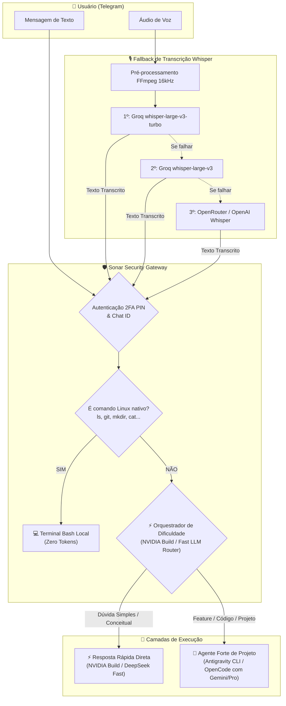

# 🛰️ SONAR: AI Terminal Bridge & Multi-Agent Orchestrator

> **Ponte bidirecional segura para controle remoto de terminal Linux e múltiplos agentes de IA (`Antigravity CLI` e `OpenCode`) via Telegram com Orquestração de Dificuldade (NVIDIA NIM / Fast Router) e Fallback em Cascata de Voz (Whisper STT).**

---

## 🏗️ Arquitetura do Sistema

---

## ⚡ Recursos Principais

### 1. 💻 Terminal Linux Nativo (Zero Tokens)
Execute comandos cotidianos diretamente pelo chat com resposta em milissegundos sem gastar cota de IA:
* `ls -la`, `pwd`, `mkdir pasta`, `cat .env.example`, `rm arquivo`
* `git status`, `git diff`, `git pull`, `git add .`, `git commit -m "..."`, `git push`
* `npm test`, `yarn build`, `composer install`, `docker ps`, `df -h`
* Comandos arbitrários com pipes usando o prefixo `/sh <cmd>` ou `$ <cmd>`.

### 2. ⚡ Orquestração de Dificuldade & Sobrevivência (NVIDIA Build / Fast Router)
Quando uma instrução em linguagem natural chega:
* **Nível 1 (Simples / Dúvida Teórica):** A IA rápida da NVIDIA / Fast Router responde instantaneamente (1-2s), poupando tempo e tokens do agente pesado.
* **Nível 2 (Complexo / Intrínseco ao Projeto):** O orquestrador detecta que a tarefa exige ler ou alterar a codebase e despacha para o **Agente Forte** (`agy` com Gemini ou `opencode`).
* **🛡️ Fallback Automático de Sobrevivência (Zero Downtime):** Se o Gemini ou OpenCode esgotarem tokens (`429`, `RESOURCE_EXHAUSTED` ou cota), o sistema automaticamente comuta para o **NVIDIA Build NIM (`Llama 3.2 90B Vision`)** para responder. Você **nunca fica sem resposta**.
* **Agente Dedicado:** Você também pode usar a NVIDIA diretamente com `/agent nvidia`.

### 3. 🎙️ Fallback em Cascata para Whisper STT
* Normalização de áudio para MP3 16kHz mono via `ffmpeg`.
* **1ª Tentativa:** Groq `whisper-large-v3-turbo` (latência ultrabaixa).
* **2ª Tentativa:** Groq `whisper-large-v3`.
* **3ª Tentativa:** OpenRouter / OpenAI Whisper.

### 4. 🛡️ Segurança Defensiva (Hardening)
* **2FA por PIN de Sessão:** Bloqueio por inatividade (`SESSION_TIMEOUT_MINUTES`) e comando manual `/lock`.
* **Chroot Jail:** Bloqueio rigoroso contra Path Traversal fora de `PROJECTS_BASE_DIR`.
* **DLP (Data Loss Prevention):** Mascaramento automático de chaves nos logs e comando `/logs`.

---

## 💬 Comandos no Telegram

| Comando | Descrição |
| :--- | :--- |
| `/unlock <PIN>` | Desbloqueia a sessão do bot |
| `/lock` | Tranca a sessão imediatamente |
| `/info` | Exibe o guia completo da arquitetura, fluxos e segurança |
| `/orchestrator on\|off` | Ativa ou desativa a triagem inteligente de dificuldade |
| `/agent [nome]` | Alterna entre `agy` e `opencode` |
| `/models` | Lista modelos recomendados para o agente ativo |
| `/model <nome>` | Define o modelo de IA |
| `/pwd` e `/cd <pasta>` | Navega pelos projetos (com proteção de Jail) |
| `/projects` | Lista repositórios autorizados |
| `/status` | Diagnóstico completo do sistema |
| `/logs` | Últimos 20 logs com DLP ativo |
| `/new` | Reseta a memória de contexto da conversa |

---

## 📄 Licença

Distribuído sob a licença **MIT**.
